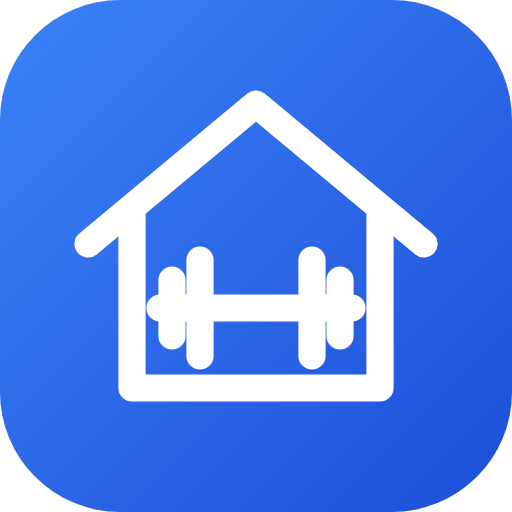
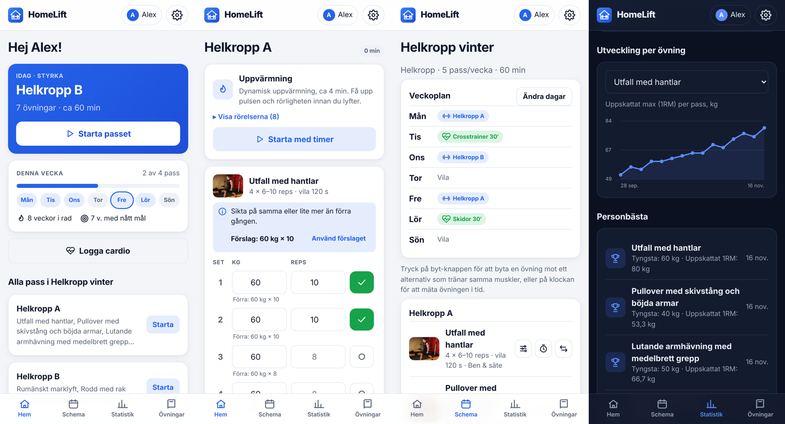
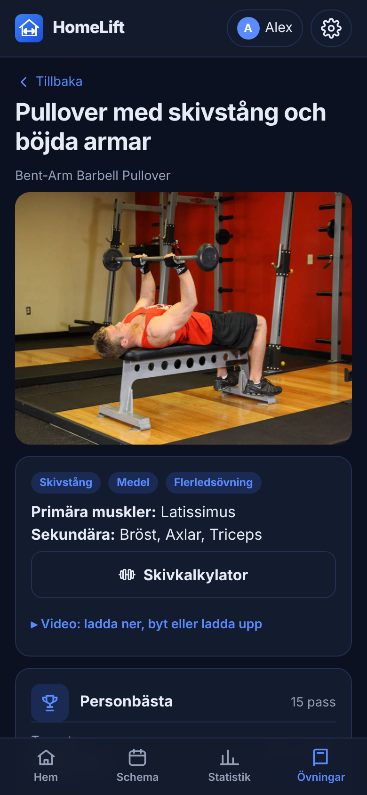
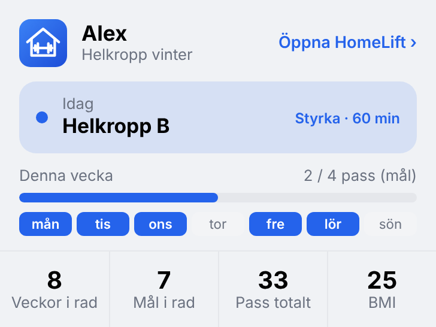

<p align="center">
  
</p>

<h1 align="center">HomeLift</h1>

<p align="center">
  <b>Ditt eget träningsprogram, på din egen server.</b><br>
  Scheman efter din utrustning, loggning av styrka och cardio, personbästa, statistik och påminnelser via Home Assistant.<br>
  Ingen molntjänst, inget konto, ingen reklam.
</p>

<p align="center">
  
</p>

---

## Vad är HomeLift?

HomeLift är en webbapp som du kör i Docker, till exempel på Unraid, och använder från mobilen. Lägg till den på hemskärmen så fungerar den som en vanlig app. Hela familjen kan ha egna profiler.

Du svarar på några frågor om vilken utrustning du har, vad du vill träna och hur ofta. HomeLift sätter ihop ett veckoschema, håller koll på vad du lyfte förra gången och säger till när det är dags att öka.

## Det här kan den

**Schema som passar dig**
- Guide som frågar efter utrustning, kroppsdelar, nivå (nybörjare, medel, avancerad), vilka veckodagar du tränar och hur långa passen ska vara.
- Rätt upplägg efter antal dagar: helkropp, över-/underkropp eller push/pull/ben.
- **Hur många scheman som helst.** Spara, döp om, växla och ta bort. Ett schema är aktivt åt gången.
- Byt ut vilken övning som helst mot ett alternativ som tränar samma muskler med din utrustning.
- Egen vilotid och antal set per övning, och **superset** där två övningar körs i följd utan vila emellan.
- **Cardiopass** i schemat: crosstrainer, löpning, skidor, cykel, rodd, promenad, simning med flera.

**Under passet**
- Logga vikt och reps per set. **Förra passets siffror står på varje setrad.**
- **Smart progression:** förslag på vikt, reps eller tid med ett tryck på "Använd förslaget", och en lättare vecka om du stått still flera pass.
- **Personbästa firas direkt** när du slår ett rekord.
- Vilotimer som startar automatiskt, med ljud av/på och notis när appen ligger i bakgrunden.
- **Skivkalkylator** som visar vilka viktskivor som ska på stången.
- Timer för tidsövningar som plankan, uppvärmning före och stretch efter passet.

**Övningar och videor**
- Ca 870 övningar med bilder och steg-för-steg-instruktioner, **på svenska och engelska**. Sök fungerar på båda språken.
- **Instruktionsvideo direkt på övningssidan.** HomeLift hittar en passande YouTube-video och bäddar in den. Du kan välja en egen länk.
- **Lokala videor utan reklam:** ladda ner till servern för dina scheman eller alla övningar, eller ladda upp en egen fil.

**Statistik och mål**
- **Veckomål** för antal pass, med framsteg och streak.
- Utvecklingskurva per övning och **rekordlista** (tyngsta vikt, flest reps, bästa 1RM, längsta tid) med datum.
- Vikt, längd och BMI med viktkurva, och **kroppsmått** (midja, bröst, armar, lår med mera) med grafer.

**Din data**
- All data i en SQLite-databas på din server.
- **Nattlig säkerhetskopia** av databasen (de senaste 14 sparas), export av allt som JSON eller CSV, och import från fil.

**Smart hem**
- **Home Assistant-integration via HACS**: sensorer för nästa pass, träningsdag idag, veckans pass, veckomål, streak, vikt och BMI.
- Eget **HomeLift-kort** för instrumentpanelen.
- **Påminnelse** till mobilen på träningsdagar via en färdig ritning (blueprint).

**Allmänt**
- Svenska och engelska i hela appen. Ljust, mörkt eller automatiskt tema.

<p align="center">
  
  &nbsp;&nbsp;
  
</p>

## Installera på Unraid

Imagen byggs automatiskt och finns på `ghcr.io/claudemicro222-cmd/homelift:latest`.

**Med mallen (enklast):**

1. Gå till **Docker → Add Container**.
2. Klistra in den här adressen i fältet **Template repositories** längst ner på sidan och tryck **Save**:
   ```
   https://github.com/claudemicro222-cmd/homelift
   ```
   Eller lägg filen [`unraid/homelift.xml`](unraid/homelift.xml) i `/boot/config/plugins/dockerMan/templates-user/`.
3. Välj mallen **homelift** under *Template*. Namn, ikon, port och datamapp fylls i. Tryck **Apply**.
4. Öppna `http://<serverns-ip>:8080` i mobilen och välj **Lägg till på hemskärmen**.

**För hand:** **Docker → Add Container** och fyll i:

| Fält | Värde |
| --- | --- |
| Name | `homelift` |
| Repository | `ghcr.io/claudemicro222-cmd/homelift:latest` |
| Icon URL | `https://raw.githubusercontent.com/claudemicro222-cmd/homelift/main/public/icon-512.png` |
| Port | container `8080` → värd `8080` (eller valfri ledig port) |
| Path | container `/data` → värd `/mnt/user/appdata/homelift` |
| Variable (valfri) | `TZ` = `Europe/Stockholm` |

**Byta namn och ikon på en befintlig container:** klicka på containerns ikon → **Edit**, ändra **Name** till `homelift` och klistra in ikonadressen ovan i **Icon URL** (syns under *Advanced View*). Tryck **Apply**. Datamappen ligger kvar.

Med Docker Compose: `docker compose up -d` med [`docker-compose.yml`](docker-compose.yml).

### Uppdatera

Varje gång en ny version pushas till `main` byggs en ny image. I Unraid: **Docker → Check for Updates → apply update**. Med compose: `docker compose pull && docker compose up -d`. Din data ligger kvar.

### Data och säkerhetskopia

Allt sparas i `/mnt/user/appdata/homelift` (monteras som `/data`):

- `homelift.db` – profiler, scheman och all träning
- `backups/` – nattliga kopior av databasen (kl 03:00, de 14 senaste sparas)
- `bilder/` – övningsbilder som hämtats
- `videos/` – nedladdade instruktionsvideor

Under **Inställningar → Säkerhetskopia** kan du ta en kopia direkt, ladda ner en kopia, exportera allt som JSON och importera en tidigare export. En kopia tas alltid automatiskt innan en import ersätter datan.

## Home Assistant

Allt sker lokalt i ditt nätverk. Instruktionerna finns också i appen under **Inställningar → Home Assistant**, med rätt adress ifylld.

### Installera med HACS

1. Öppna **HACS → ⋮ (uppe till höger) → Anpassade arkiv** (*Custom repositories*).
2. Lägg till `https://github.com/claudemicro222-cmd/homelift` med typen **Integration**.
3. Sök efter **HomeLift** i HACS, tryck **Ladda ner** och starta om Home Assistant.
4. **Inställningar → Enheter och tjänster → Lägg till integration → HomeLift**, ange `http://<serverns-ip>:8080`.

Kortet följer med integrationen och behöver inte installeras separat.

<details>
<summary>Utan HACS</summary>

Öppna en terminal i Home Assistant (tillägget *Terminal & SSH*) och kör:

```sh
curl -fsSL http://<serverns-ip>:8080/ha/install.sh | sh
```

Integrationen och påminnelseritningen hämtas direkt från din HomeLift-server. Starta sedan om Home Assistant och lägg till integrationen som i steg 4 ovan.
</details>

### Kortet

Redigera en instrumentpanel → *Lägg till kort* → sök efter *HomeLift*. Eller i YAML:

```yaml
type: custom:homelift-card
entity: sensor.homelift_alex_nasta_pass
```

Byt `alex` mot namnet på din profil.

### Påminnelser

Importera ritningen med ett klick:

[](https://my.home-assistant.io/redirect/blueprint_import/?blueprint_url=https%3A%2F%2Fgithub.com%2Fclaudemicro222-cmd%2Fhomelift%2Fblob%2Fmain%2Fblueprints%2Fhomelift_reminder.yaml)

Skapa sedan en automation: *Inställningar → Automationer → Skapa automation → Från ritning* → **HomeLift – påminnelse på träningsdagar**. Välj profilens sensor *Träningsdag idag*, tid och mobil.

### Sensorer

Varje profil blir en enhet med sensorerna *Nästa pass*, *Träningsdag idag*, *Pass denna vecka*, *Veckomål*, *Veckomål nått*, *Veckor i rad*, *Veckor med nått mål*, *Pass totalt*, *Senaste pass*, *Nästa träningsdag*, *Vikt* och *BMI*.

## Instruktionsvideor

Övningssidan bäddar in en YouTube-video som HomeLift letar upp själv. Gillar du inte videon kan du klistra in en egen länk. Inbäddade videor kommer från YouTube och kan visa reklam.

Vill du slippa reklam kan du ladda ner videor till servern under **Inställningar → Instruktionsvideor**. De hämtas med [yt-dlp](https://github.com/yt-dlp/yt-dlp), som installeras och uppdateras automatiskt i `/data/bin`. Räkna med ca 100 MB för ett schema och ca 8 GB för alla övningar. Du kan också ladda upp en egen fil på övningens sida. En nedladdad video visas alltid i stället för den inbäddade.

Videorna är för eget bruk. YouTubes villkor tillåter inte nedladdning, så det sker på eget ansvar.

## Nå appen utanför hemmet

HomeLift har ingen inloggning, så exponera den inte öppet mot internet. Använd hellre Tailscale (finns som plugin i Unraid) eller en reverse proxy med inloggning. Notiser från vilotimern kräver att appen öppnas via https, till exempel via Tailscale eller en reverse proxy.

## Ändringar

Önskade ändringar och vad som ingår i varje version finns i [ANDRINGAR.md](ANDRINGAR.md).

## Teknik

- Node.js 22 utan externa npm-paket. Databasen är SQLite via Nodes inbyggda `node:sqlite`.
- Frontend i vanlig JavaScript, installerbar som app (PWA).
- Övningsdata: [free-exercise-db](https://github.com/yuhonas/free-exercise-db) (public domain). Svenska översättningar i `data/exercises.sv.json`.

Köra lokalt utan Docker:

```sh
DATA_DIR=./userdata node --no-warnings src/server.js
```

```
src/server.js              API och databas
src/generator.js           Schemagenerator, tidsövningar och cardiotyper
src/videos.js              Inbäddade och lokala instruktionsvideor
src/backup.js              Säkerhetskopior, export och import
src/ha.js                  API och installationsfiler för Home Assistant
public/                    Appen (HTML, CSS, JS, översättningar, ikoner, service worker)
data/                      Övningsdatabasen och svenska översättningar
custom_components/         Home Assistant-integrationen och Lovelace-kortet (HACS)
blueprints/                Påminnelseritningen
unraid/                    Unraid-mall
.github/workflows/         Bygger och publicerar Docker-imagen
```

## Licens

MIT. Övningsdata från free-exercise-db är public domain.
